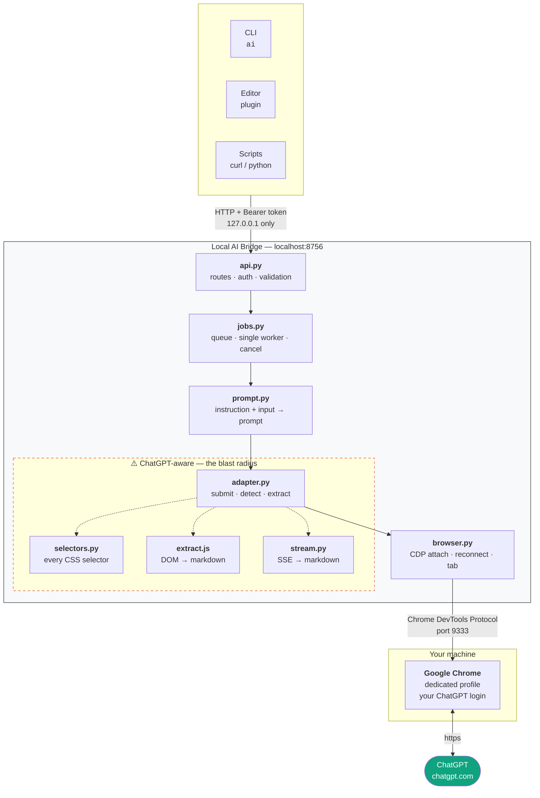
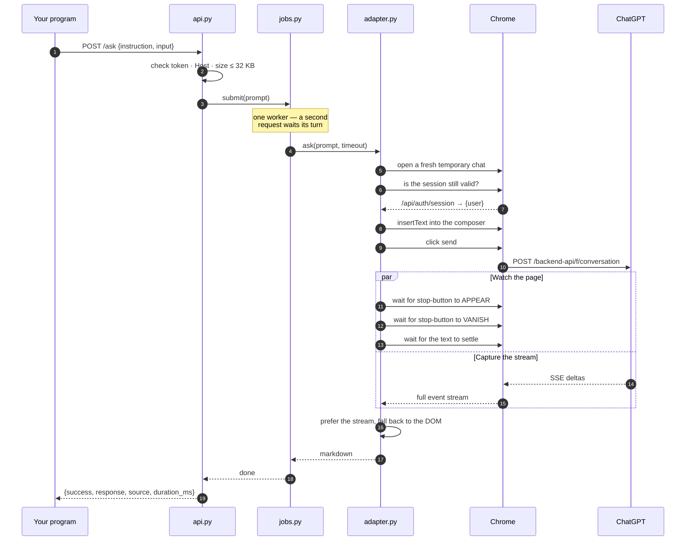
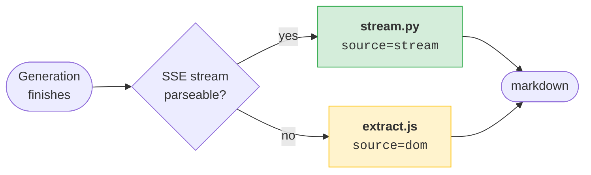
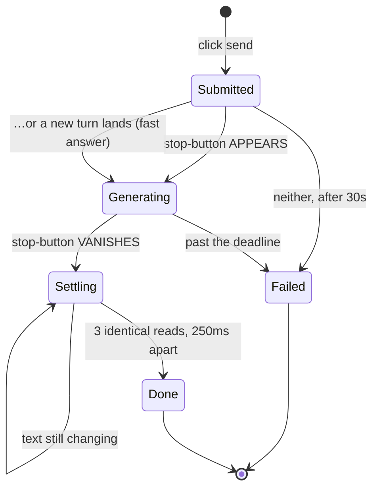
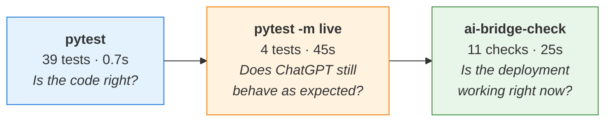

<div align="center">

# 🌉 AI Bridge

**A local HTTP gateway to your own ChatGPT web session.**

Send text in, get the answer back — from any program on your machine.
No API key, no copy-pasting into a browser tab.


</div>

---

```console
$ ai "Explain this simply" --input 'function add(a,b){return a+b}'
This function adds two numbers together.

$ cat main.py | ai "Find the bug"
Division by zero in `f()` raises a ZeroDivisionError instead of returning a value.

$ git diff | ai "Write a commit message" | git commit -F -
```

---

## Contents

| | |
|---|---|
| [What it is](#-what-it-is) · [Quick start](#-quick-start) · [Daily use](#-daily-use) | Getting going |
| [Architecture](#-architecture) · [Request lifecycle](#-request-lifecycle) · [Extraction](#-how-the-answer-is-extracted) | How it works |
| [HTTP API](#-http-api) · [CLI](#-cli) · [Errors](#-error-codes) | Reference |
| [Security](#-security) · [Testing](#-testing) · [Troubleshooting](#-troubleshooting) | Operating it |
| [Design decisions](#-design-decisions) · [Limits](#-limits-and-risks) · [Status](#-status) | Background |

---

## 🎯 What it is

Without this, using ChatGPT from a program means doing it all by hand:

```
open browser → paste input → type instruction → submit → wait → copy → paste back
```

With it:

```
POST /ask   →   answer
```

The service keeps an authenticated ChatGPT tab alive in the background and drives it
for you. Everything ChatGPT-specific is hidden behind one endpoint, so the calling
program neither knows nor cares how the answer was produced.

It is **task-agnostic** — it is not a grammar tool or a code tool. Whatever you would
type into ChatGPT, you can send it:

<table>
<tr>
<td>

- Explain code
- Generate code
- Rewrite text
- Translate

</td>
<td>

- Summarise
- Answer questions
- Extract data
- Classify

</td>
<td>

- Structured output
- Content analysis
- Commit messages
- …anything else

</td>
</tr>
</table>

---

## 🚀 Quick start

> **Prerequisites:** Linux, Python 3.12, Google Chrome, and a ChatGPT account.

```bash
sudo apt install python3.12-venv          # one-time, if missing
python3 -m venv .venv
.venv/bin/pip install -r requirements.txt
```

Playwright's bundled browsers are **not** needed — the bridge attaches to your system
Chrome.

```bash
bin/ai-bridge-ctl start                   # starts Chrome + the service
```

A Chrome window opens. **Log into ChatGPT in it, once.** That profile is separate
from your everyday browser and the login persists on disk across reboots.

```bash
bin/ai-bridge-check                       # 11 checks, ~25s — confirms it all works
```

Optionally add the shortcuts to `~/.zshrc`:

```bash
AI_BRIDGE_HOME="$HOME/Desktop/my_proj/free_chatGpt_Api"
alias ai="$AI_BRIDGE_HOME/bin/ai-bridge ask -i"
alias ai-up="$AI_BRIDGE_HOME/bin/ai-bridge-ctl start"
alias ai-down="$AI_BRIDGE_HOME/bin/ai-bridge-ctl stop"
alias ai-status="$AI_BRIDGE_HOME/bin/ai-bridge-ctl status"
alias ai-check="$AI_BRIDGE_HOME/bin/ai-bridge-check"
```

---

## ⚡ Daily use

```bash
ai-up            # start          (~3 seconds)
ai "..."         # use
ai-down          # stop           (frees ~1.7 GB of RAM)
```

Nothing auto-starts, deliberately — it runs a second Chrome, and that is real memory.
Install `systemd/*.service` if you would rather it came up with your desktop.

---

## 🏗 Architecture

Everything that knows ChatGPT exists is confined to the bottom layer. That is the
single most important property of the design: when ChatGPT redesigns their site —
and they will — the damage is contained to four files.



Above that line, the rest of the system talks to a three-method interface —
`ask()`, `health()`, `close()`. Swapping ChatGPT for the OpenAI API later means
writing one new file that implements those three; `/ask` never changes.

---

## 🔄 Request lifecycle



---

## 📤 How the answer is extracted

Two independent paths, tried in order. This redundancy is not over-engineering — it
was added *because* the DOM path was caught losing information on day one.



| | **1. SSE stream** *(preferred)* | **2. DOM** *(fallback)* |
|---|---|---|
| Source | ChatGPT's own `POST /backend-api/f/conversation` event stream | The rendered page |
| Fidelity | The original markdown, exactly as generated | Reconstructed; **code fences lose their language** |
| Breaks when | The wire format changes | The page markup changes |
| Tested by | A real captured stream in `tests/fixtures/` | `pytest -m live` |

Every response reports which one answered:

```json
{ "success": true, "response": "...", "source": "stream" }
```

A sustained `"source": "dom"` means the wire format moved and `stream.py` needs
updating. `bin/ai-bridge-check` asserts on this, so you find out on a schedule rather
than by noticing degraded output weeks later.

### Completion detection

Never a fixed sleep. ChatGPT swaps its send button for a stop button while generating,
which gives a real state machine:



> **Why wait for the button to *appear* first?** Waiting only for "stop button gone"
> races a button that has not changed yet, and returns instantly with an empty answer.
> The settle guard then absorbs the re-render ChatGPT does after streaming ends.

---

## 🔌 HTTP API

Listens on `127.0.0.1:8756`. Every endpoint except `/health` needs
`Authorization: Bearer <token>`.

| Method | Endpoint | Purpose |
|:---|:---|:---|
| `POST` | `/ask` | Ask and wait for the answer |
| `POST` | `/ask?async=1` | Returns `{job_id}` immediately (202) |
| `GET` | `/jobs/{id}` | `queued` · `running` · `done` · `failed` · `cancelled` |
| `DELETE` | `/jobs/{id}` | Cancel — clicks stop-generating if running, and answers with the settled status |
| `GET` | `/health` | No auth. Browser, tab, login, challenge, queue depth |
| `GET` | `/health/dom` | Selector canary — **run this first when things break** |

<details>
<summary><b>Request and response shapes</b></summary>

**Request**

```json
{
  "instruction": "Explain this in simple terms",
  "input": "function add(a,b){return a+b}",
  "timeout": 120,
  "new_chat": true
}
```

`input` is optional. `new_chat: false` continues the previous conversation.
Combined size is capped at 32 KB.

**Success**

```json
{
  "success": true,
  "response": "This function adds two numbers together.",
  "job_id": "j_4a4a998ca25e6745",
  "duration_ms": 7936,
  "source": "stream"
}
```

**Failure** — always this shape, always with a code you can branch on:

```json
{
  "success": false,
  "error": {
    "code": "CHATGPT_NOT_AUTHENTICATED",
    "message": "The ChatGPT session requires authentication.",
    "hint": "Log in manually in the ai-bridge Chrome window."
  }
}
```

</details>

<details>
<summary><b>Calling it from Python</b></summary>

```python
import requests, tomllib, pathlib

cfg = tomllib.loads(
    (pathlib.Path.home() / ".config/ai-bridge/config.toml").read_text())

r = requests.post(
    "http://localhost:8756/ask",
    headers={"Authorization": f"Bearer {cfg['server']['token']}"},
    json={"instruction": "Explain this", "input": open("main.py").read()},
    timeout=300,
).json()

print(r["response"] if r["success"] else r["error"]["code"])
```

</details>

---

## 💻 CLI

```bash
ai "What is the capital of France?"                 # instruction only
ai "Explain this simply" --input 'const x = 1'      # inline input
ai "Find the bug" --input-file main.py              # from a file
cat main.py | ai "Find the bug"                     # from stdin
ai "Now in one sentence" --continue                 # same conversation
ai "Summarise" --input-file long.txt --timeout 300  # slow answers
```

Only the answer goes to **stdout** — status and errors go to stderr — so it composes:

```bash
cat notes.txt | ai "Summarise as bullets" > summary.md
git diff | ai "Write a commit message" | git commit -F -
```

| Command | Does |
|:---|:---|
| `ai-up` | Start Chrome + service |
| `ai-down` | Stop both, free the RAM |
| `ai-status` | What is running right now |
| `ai-check` | Full end-to-end test, 11 checks |

---

## ❗ Error codes

Every failure is typed. Nothing reaches a client as an untyped exception, and an
empty answer is never reported as success.

| Code | HTTP | Meaning | Fix |
|:---|:--:|:---|:---|
| `BROWSER_UNAVAILABLE` | 503 | Nothing on the CDP port | `ai-up` |
| `BROWSER_DISCONNECTED` | 503 | CDP dropped mid-request | Auto-reconnects |
| `CHATGPT_TAB_UNAVAILABLE` | 503 | Tab closed, reopen failed | `ai-down && ai-up` |
| `CHATGPT_NOT_AUTHENTICATED` | 401 | Logged out / expired | Log in, in the Chrome window |
| `CHATGPT_CHALLENGE_REQUIRED` | 503 | Cloudflare human check | Click it yourself |
| `CHATGPT_PAGE_LOAD_FAILED` | 503 | Navigation failed | Usually transient |
| `CHATGPT_RATE_LIMITED` | 429 | Message cap, or the "Too many requests" throttle | Wait a few minutes |
| `PROMPT_SUBMIT_FAILED` | 502 | Composer/send unusable (retried once) | Check `/health/dom` |
| `GENERATION_TIMEOUT` | 504 | Never finished | Raise `timeout` |
| `RESPONSE_EXTRACT_FAILED` | 502 | Finished, nothing extractable | Check `/health/dom` |
| `CHATGPT_DOM_CHANGED` | 502 | **They shipped a redesign** (retried once) | Fix `selectors.py` |
| `REQUEST_CANCELLED` | 499 | Client cancelled | — |
| `INPUT_TOO_LARGE` | 413 | Over 32 KB | Send less |
| `BUSY` | 503 | More than 10 queued | Wait |
| `UNAUTHORIZED` / `FORBIDDEN_HOST` | 401 / 403 | Bad token / non-loopback Host | — |

> `CHATGPT_DOM_CHANGED` is the important one. Telling "the page changed" apart from
> "generation was slow" is the difference between a ten-second fix and an hour of
> confused debugging — which is why the DOM is probed *before* submitting, not after
> a timeout.

---

## 🔒 Security

| | |
|:---|:---|
| **Loopback only** | Binds `127.0.0.1`; refuses to start on anything else |
| **Bearer token** | 32 random bytes, generated on first run, compared with `compare_digest` |
| **Host checked** | Non-loopback `Host` headers rejected — blocks DNS rebinding from a web page |
| **No CORS** | Deliberately absent |
| **Size capped** | 32 KB, enforced before the browser is touched |
| **Quiet logs** | Prompts and responses never logged unless `log_bodies = true` |
| **No credentials** | Login is manual, in the browser. The app never sees a password |
| **Ephemeral results** | In memory only, evicted 10 minutes after completion |

Loopback alone would not be enough — any local process, including a browser extension
or a malicious `npm postinstall`, can reach `localhost`. Hence the token.

> ⚠️ `~/.local/share/ai-bridge/chrome-profile/` holds live ChatGPT session cookies.
> It is `chmod 700`. Anyone who can read it is logged in as you. Never commit it,
> never back it up unencrypted.

---

## 🧪 Testing

Three layers, answering three different questions.



```bash
.venv/bin/pytest             # no browser needed — API, prompt building, SSE parser
.venv/bin/pytest -m live     # real round-trips, drives the adapter directly
bin/ai-bridge-check          # the running service, over HTTP, like a real client
```

```console
$ bin/ai-bridge-check

infrastructure
  PASS browser reachable on CDP (17ms) Chrome/150.0.7871.114
  PASS service responding (159ms)
  PASS ChatGPT session authenticated (0ms)
  PASS no Cloudflare challenge pending (0ms)
  PASS page selectors intact (21ms)

security
  PASS rejects a bad token (5ms)
  PASS rejects a non-loopback Host (1ms)
  PASS rejects oversized input (1ms)

round trips
  PASS answers a prompt (7938ms)
  PASS answer came from the SSE stream, not the DOM fallback  source=stream
  PASS async job completes (8013ms) done

all 11 checks passed
```

Exits non-zero on failure, so it doubles as the scheduled canary:

```bash
cp systemd/ai-bridge-check.* ~/.config/systemd/user/
systemctl --user enable --now ai-bridge-check.timer     # weekly, notifies on failure
```

`tests/fixtures/sse_code_block.txt` is a verbatim 10 KB capture of a real ChatGPT
stream. When the wire format changes, the parser tests fail — which is the point.

---

## 🔧 Troubleshooting

**Always start with `ai-check`.** It names the broken part.

| `ai-check` says | What happened | What to do |
|:---|:---|:---|
| `ChatGPT session authenticated` FAILED | Login expired | `ai-up`, log in, in that Chrome window |
| `no Cloudflare challenge pending` FAILED | Bot check | Click the checkbox yourself. Expected occasionally |
| `browser reachable on CDP` FAILED | Chrome gone (often OOM) | `ai-up` |
| `page selectors intact` FAILED | **ChatGPT redesigned** | Fix `ai_bridge/selectors.py` |
| `answer came from the SSE stream` FAILED | Wire format moved | Fix `ai_bridge/stream.py` — answers still correct meanwhile |
| All pass, still wrong | — | `tail -f ~/.cache/ai-bridge/bridge.log` during a request |

Every failed `ask` also leaves a screenshot in `~/.cache/ai-bridge/failures/`, named
`<timestamp>-<ERROR_CODE>-try<n>.png`. One image usually identifies a redesign faster
than any log line. The last 20 are kept; older ones delete themselves.

`PROMPT_SUBMIT_FAILED` and `CHATGPT_DOM_CHANGED` are retried once, in a fresh
temporary chat, before they reach you — a stale page is a large share of both. If you
see one, the reload did not fix it.

A throttle modal (*"Too many requests — you're making requests too quickly"*) sits on
top of the composer and swallows the click, so it arrives as `CHATGPT_RATE_LIMITED`,
not `PROMPT_SUBMIT_FAILED` — and is deliberately **not** retried, because retrying a
throttle is how you earn a longer one. Back off for a few minutes.

The service deliberately does **not** try to defeat Cloudflare. Stealth plugins and
captcha-solvers are what actually get accounts banned; a human clicking a checkbox
once in a while does not.

```bash
ai-down && ai-up      # nothing is ever lost by restarting
```

<details>
<summary><b>Where everything lives</b></summary>

```
~/.config/ai-bridge/config.toml              port + API token        (0600)
~/.local/share/ai-bridge/chrome-profile/     your ChatGPT login      (0700)
~/.cache/ai-bridge/bridge.log                service log
~/.cache/ai-bridge/chrome.log                browser log
~/.cache/ai-bridge/failures/                 screenshot per failed ask, last 20
```

</details>

---

## 🧠 Design decisions

<details open>
<summary><b>Attach to a real Chrome — never launch Chromium</b></summary>

The single decision the project lives or dies by. Cloudflare flags a
Playwright-launched Chromium almost immediately: wrong browser build, headless
signals, automation flags, a cold profile with no history.

Attaching over CDP to a Chrome *you* launched keeps a genuine fingerprint and a warm
profile. In practice this is the difference between "works" and "blocked".

> **Chrome ≥ 136 gotcha:** `--remote-debugging-port` is ignored on the default
> user-data-dir. A dedicated profile is mandatory — you cannot attach to your
> everyday browser.

</details>

<details>
<summary><b>A fresh temporary chat per request</b></summary>

One persistent conversation bleeds context between unrelated callers — a translation
request picks up flavour from the previous caller's code review — and eventually hits
the context limit anyway. Temporary chats also stay out of your ChatGPT history and
out of training. Cost is one ~2s navigation per request. `new_chat: false` opts out.

</details>

<details>
<summary><b>Jobs from day one, even though /ask is synchronous</b></summary>

`/ask` creates a job and awaits it. That made `?async=1`, `GET /jobs/{id}` and
cancellation essentially free — about 60 lines — where retrofitting them later would
not have been.

</details>

<details>
<summary><b>One worker, one tab</b></summary>

Parallel tabs multiply bot-detection risk for near-zero gain at personal scale.
A second request queues.

</details>

<details>
<summary><b>Ask ChatGPT whether you're logged in — don't guess from the DOM</b></summary>

The original check looked for the composer. It reported "authenticated" while logged
out, because logged-out ChatGPT renders a composer too. It now calls
`/api/auth/session`, which is unambiguous and survives redesigns.

</details>

---

## ⚖️ Limits and risks

| | |
|:---|:---|
| ⏱ **Throughput** | One request at a time, 8–10s each. Personal scale — roughly 100–200/day before account caps |
| 🧠 **Memory** | A second Chrome costs ~1.8 GB resident. On a tight box the OOM killer may take it; the bridge reconnects once it's back |
| 🔄 **Fragility** | ChatGPT's frontend changes often. Contained to four files, surfaced by `ai-check`, but it *will* need occasional repair |
| 🛡 **Detection** | Cloudflare has stayed quiet so far, but that can change at any time. A challenge is handled by you clicking once |
| 🚦 **Throttling** | Repeated *short, near-identical* prompts in quick succession trip ChatGPT's own "Too many requests" modal — see below. Real use does not go near it |
| 📜 **Terms of use** | Automating the ChatGPT web UI is **against OpenAI's Terms of Use**. Personal scale, your own account, your own risk |

> **On throttling.** The limit you will hit is ChatGPT's application-layer throttle,
> not Cloudflare. It keys off the *shape* of the traffic, not just the volume: dozens
> of tiny near-identical prompts, each in a fresh temporary chat, back to back with no
> pacing. The modal sits **on top of the composer** and swallows the click, so it
> arrives as `CHATGPT_RATE_LIMITED` (429), and is deliberately **not** retried —
> retrying is how a few minutes becomes a lot longer. Asking real questions at human
> pace is nowhere near this; it is a testing hazard, not a usage limit.

**If ChatGPT ever blocks this properly**, the exit is already designed: an OpenAI API
adapter behind the same `/ask` endpoint. One new file. Nothing built on top of the
bridge would change.

---

## 📊 Status

| Phase | | |
|:---|:---|:---|
| 0 · Feasibility spike | ✅ | Passed — no challenges across ~20 round-trips |
| 1 · Adapter | ✅ | Submit, detect, extract, reconnect |
| 2 · Service | ✅ | API, jobs, cancel, health |
| 3 · CLI + tests | ✅ | 39 unit + 4 live |
| 4 · Background service | ⚠️ | Units written, not installed — by choice, for memory |
| 5 · Hardening | ✅ | SSE · canary · rate limits · screenshots · one retry |
| 6–7 · More clients, streaming | ⛔ | Speculative until something needs them |

Working MVP was reached at Phase 3; everything after is hardening.

**Next:** use it for a week. The two open questions — does Cloudflare stay quiet at
volume, and how fast does the frontend drift — cannot be answered by writing more code.

<details>
<summary><b>Project layout</b></summary>

```
ai_bridge/
├── api.py          routes · auth · validation
├── jobs.py         queue · single worker · cancellation
├── prompt.py       instruction + input → prompt
├── adapter.py   ⚠️ submit · detect completion · extract
├── selectors.py ⚠️ every CSS selector, alone
├── extract.js   ⚠️ DOM → markdown (fallback)
├── stream.py    ⚠️ SSE → markdown (preferred)
├── browser.py      CDP attach · reconnect · tab
├── config.py       TOML + token
└── errors.py       typed error codes

bin/
├── ai-bridge          CLI client (stdlib only)
├── ai-bridge-ctl      start · stop · status
├── ai-bridge-check    11-check end-to-end test
└── start-chrome.sh    dedicated-profile launcher

tests/               unit · live · SSE fixtures
systemd/             service + canary timer units
```

⚠️ = knows ChatGPT exists. A redesign touches only these.

</details>

---

<div align="center">

**📄 [USAGE.txt](USAGE.txt)** — plain-English procedure ·
**📐 [IMPLEMENTATION_PLAN.md](IMPLEMENTATION_PLAN.md)** — feasibility analysis & design rationale

<sub>Built for personal use. Not affiliated with OpenAI.</sub>

</div>
